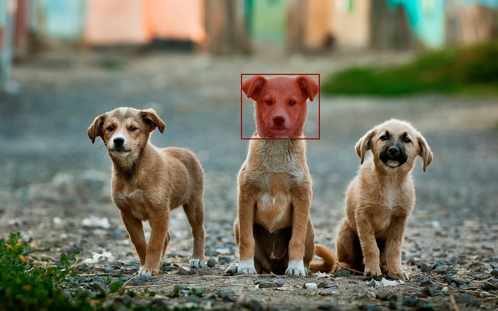
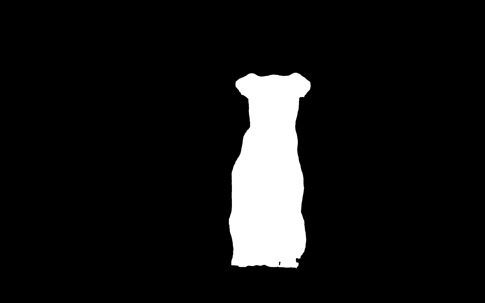

<div align="center">
  <h1>Osam</h1>
  <p>
    Run promptable vision models locally, on CPU, CUDA or CoreML.
  </p>
  <p>
    <a href="https://pypi.python.org/pypi/osam"></a>
    <a href="https://pypi.org/project/osam"></a>
    <a href="https://github.com/wkentaro/osam/blob/main/LICENSE"></a>
  </p>
  <br>
  
  
  
</div>

*Osam* (/oʊˈsɑm/) is a tool to run open-source promptable vision models locally
(inspired by [Ollama](https://github.com/ollama/ollama)).

*Osam* provides:

- **Promptable Vision Models** - Segment Anything Model (SAM), EfficientSAM, YOLO-World;
- **Local APIs** - CLI & Python & HTTP interface;
- **Customization** - Host custom vision models.

## Installation

### Pip

```bash
pip install osam[cpu]  # or osam[gpu] for NVIDIA GPUs
```

`osam[gpu]` installs `onnxruntime-gpu` together with the CUDA and cuDNN
libraries, so no system CUDA install is needed. Install only one onnxruntime
build: `onnxruntime` and `onnxruntime-gpu` overwrite each other's files.

**For `osam serve`**:

```bash
pip install osam[cpu,serve]
```

## Quickstart

To run with EfficientSAM:

```bash
osam run efficientsam --image <image_file>
```

To run with YOLO-World:

```bash
osam run yoloworld --image <image_file>
```

## Model library

Here are models that can be downloaded:

| Model | Parameters | Size | Download |
| ---------------- | ---------- | ----- | --------------------------- |
| SAM 100M | 94M | 100MB | `osam run sam:100m` |
| SAM 300M | 313M | 310MB | `osam run sam:300m` |
| SAM 600M | 642M | 630MB | `osam run sam` |
| SAM2 Tiny | 39M | 150MB | `osam run sam2:tiny` |
| SAM2 Small | 46M | 170MB | `osam run sam2:small` |
| SAM2 BasePlus | 82M | 300MB | `osam run sam2` |
| SAM2 Large | 227M | 870MB | `osam run sam2:large` |
| SAM3 | 893M | 3.4GB | `osam run sam3` |
| EfficientSAM 10M | 10M | 40MB | `osam run efficientsam:10m` |
| EfficientSAM 30M | 26M | 100MB | `osam run efficientsam` |
| YOLO-World XL | 168M | 640MB | `osam run yoloworld` |

PS. `sam`, `efficientsam` is equivalent to `sam:latest`, `efficientsam:latest`.

### Prompts

| Model | Point | Box | Negative box | Text |
| ------------ | :---: | :---: | :---: | :---: |
| SAM | ✓ | ✓ | | |
| SAM2 | ✓ | ✓ | | |
| SAM3 | ✓ | ✓ | ✓ | ✓ |
| EfficientSAM | ✓ | ✓ | | |
| YOLO-World | | | | ✓ |

### Speed

Median of 5 runs after a warm-up, excluding model loading.

#### Image encoding (ms)

| Model | CPU<br>i9-12900K | CUDA<br>RTX 3080 Ti | CPU<br>Apple M5 | CoreML<br>Apple M5 |
| ---------------- | ---: | ---: | ---: | ---: |
| SAM 100M | 1255 | 692 | 2267 | 257678 |
| SAM 300M | 2633 | 2125 | 6778 | > 15 min |
| SAM 600M | 4165 | 4197 | 11023 | > 15 min |
| SAM2 Tiny | 569 | 65 | 1627 | 277 |
| SAM2 Small | 651 | 74 | 2119 | 320 |
| SAM2 BasePlus | 1237 | 104 | 2923 | 570 |
| SAM2 Large | 2414 | 151 | 7596 | 1281 |
| SAM3 | 6512 | 348 | 15233 | 2425 |
| EfficientSAM 10M | 399 | 55 | 781 | fails to load |
| EfficientSAM 30M | 948 | 74 | 1767 | fails to load |
| YOLO-World XL | — | — | — | fails to load |

#### One prompt (ms)

Point prompt; text for SAM3 and YOLO-World, which has no separate
encoding.

| Model | CPU<br>i9-12900K | CUDA<br>RTX 3080 Ti | CPU<br>Apple M5 | CoreML<br>Apple M5 |
| ---------------- | ---: | ---: | ---: | ---: |
| SAM 100M | 32 | 20 | 47 | 84 |
| SAM 300M | 33 | 23 | 53 | — |
| SAM 600M | 34 | 27 | 52 | — |
| SAM2 Tiny | 40 | 16 | 59 | 66 |
| SAM2 Small | 44 | 17 | 58 | 61 |
| SAM2 BasePlus | 50 | 17 | 51 | 65 |
| SAM2 Large | 43 | 17 | 48 | 60 |
| SAM3 | 1174 | 75 | 1426 | 373 |
| EfficientSAM 10M | 45 | 16 | 34 | fails to load |
| EfficientSAM 30M | 46 | 15 | 35 | fails to load |
| YOLO-World XL | 774 | 42 | 1829 | fails to load |

Measured on `examples/_images/dogs.jpg` (2560x1600) with onnxruntime 1.23.2
(onnxruntime-gpu 1.31.1 for CUDA).
Run `python examples/benchmark.py --device cpu --device cuda` to measure on
your machine.
See [docs/benchmark.md](docs/benchmark.md) for SAM3 per prompt, load times
and CPU/CoreML parity.

### Custom download endpoint

Models are downloaded from their canonical URLs by default. To download from a
mirror instead (for example, in networks where the canonical hosts are blocked),
set `OSAM_BLOB_ENDPOINT` to a comma-separated list of endpoints tried in order:

```bash
# Try the mirror first, then fall back to the canonical host.
export OSAM_BLOB_ENDPOINT="https://mirror.example.com,direct"
```

Each blob is fetched from `<endpoint>/<sha256-hex>`; the reserved value `direct`
uses the model's canonical URL. Downloads are verified by SHA-256 regardless of
the endpoint, so a mirror cannot serve corrupted data. When unset, only `direct`
is used. Omit `direct` from the list (for example
`OSAM_BLOB_ENDPOINT="https://mirror.example.com"`) to disable the canonical
fallback and serve every blob from the mirror only.

### Execution providers

Pick a device per model with `--device` on the CLI or `device=` in Python:

```bash
osam run sam3 --image examples/_images/dogs.jpg --text dog --device coreml
```

```python
model = osam.apis.get_model_type_by_name("sam3")(device="cuda")
```

`cpu`, `cuda` and `coreml` are supported. An unavailable device raises an
error instead of falling back to CPU. With `coreml`, SAM3 runs its point
decoder on CPU and the rest on CoreML.

Without a device, inference runs on `CUDAExecutionProvider` when the installed onnxruntime has it,
otherwise on `CPUExecutionProvider`. To use another accelerator (CoreML on
macOS, DirectML on Windows, TensorRT, ROCm), set `OSAM_ONNX_PROVIDERS` to a
comma-separated list tried in the given order:

```bash
export OSAM_ONNX_PROVIDERS="CoreMLExecutionProvider,CPUExecutionProvider"
```

CoreML ships in the `osam[cpu]` build on macOS. For DirectML and other
builds, install `osam` without extras plus the matching onnxruntime package
(for example `onnxruntime-directml`). If a session cannot be created with the
given list, osam logs the error and falls back to `CPUExecutionProvider`.

## Usage

### CLI

```bash
# Run a model with an image
osam run efficientsam --image examples/_images/dogs.jpg > output.png

# Get a JSON output
osam run efficientsam --image examples/_images/dogs.jpg --json
# {"model": "efficientsam", "mask": "..."}

# Give a prompt
# 1. point prompt (x,y[,label]: foreground=1 by default, background=0)
osam run efficientsam --image examples/_images/dogs.jpg \
  --point 1439,504 --point 1439,1289 > efficientsam_point.png
# 2. box prompt with sam2 (x1,y1,x2,y2)
osam run sam2 --image examples/_images/dogs.jpg \
  --box 1233,376,1649,691 > sam2_box.png
# 3. text prompt
osam run sam3 --image examples/_images/dogs.jpg --text dog > sam3_text.png
# 4. box prompt with sam3
osam run sam3 --image examples/_images/dogs.jpg \
  --box 1233,376,1649,691 > sam3_box.png
# 5. text prompt with sam3, excluding a region
osam run sam3 --image examples/_images/dogs.jpg \
  --text dog --negative-box 1200,400,1700,1400 > sam3_negative_box.png

# Or give the whole prompt as JSON (point labels: background=0, foreground=1,
# box=2,3, negative box=4,5)
osam run sam2 --image examples/_images/dogs.jpg \
  --prompt '{"points": [[1233, 376], [1649, 691]], "point_labels": [2, 3]}'
# from a file (@prompt.json) or stdin (-), with a threshold on top
osam run sam3 --image examples/_images/dogs.jpg --prompt @prompt.json \
  --score-threshold 0.5
```

   \
<i>Output images: 'efficientsam_point.png', 'sam2_box.png', 'sam3_text.png', 'sam3_box.png'</i>

### Python

```python
import numpy as np
from PIL import Image

import osam

image = np.asarray(Image.open("examples/_images/dogs.jpg"))
request = osam.types.GenerateRequest(
    model="efficientsam",
    image=image,
    prompt=osam.types.Prompt(points=[[1439, 504], [1439, 1289]], point_labels=[1, 1]),
)
response = osam.apis.generate(request=request)
annotation = response.annotations[0]
mask = np.zeros(image.shape[:2], dtype=np.bool_)
bbox = annotation.bounding_box
mask[bbox.ymin:bbox.ymax + 1, bbox.xmin:bbox.xmax + 1] = annotation.mask
Image.fromarray(mask).save("mask.png")
```

 \
<i>Input and output images ('dogs.jpg', 'mask.png').</i>

### HTTP

```bash
# pip install osam[cpu,serve]  # required for `osam serve`

# Get up the server
osam serve

# POST request
base64 < examples/_images/dogs.jpg \
  | jq -Rs '{model: "efficientsam", image: gsub("\n"; "")}' \
  | curl 127.0.0.1:11368/api/generate -X POST --json @- \
  | jq -r '.annotations[0].mask' | base64 --decode > mask.png
```
