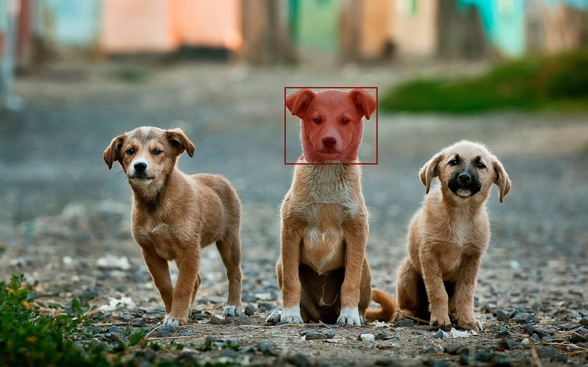
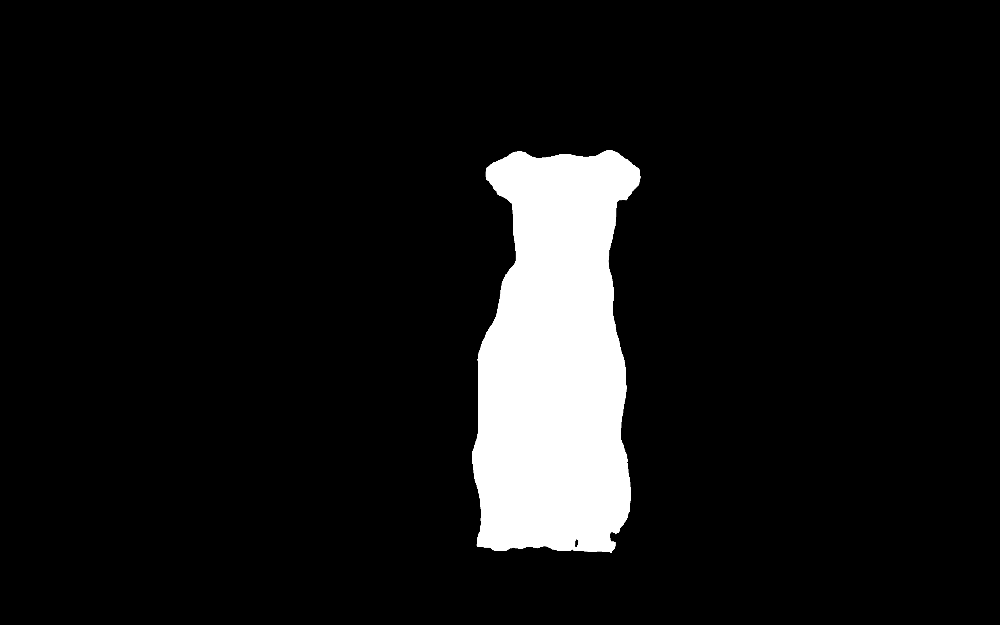

<div align="center">
  <h1>Osam</h1>
  <p>
    Run promptable vision models locally, on CPU, CUDA, WebGPU or CoreML.
  </p>
  <p>
    <a href="https://pypi.python.org/pypi/osam"></a>
    <a href="https://pypi.org/project/osam"></a>
    <a href="https://github.com/wkentaro/osam/blob/main/LICENSE"></a>
  </p>
  <br>
  
  
  
</div>

*Osam* (/oʊˈsɑm/) is a Python library and CLI that runs open-source promptable
vision models locally. Applications such as
[labelme](https://github.com/wkentaro/labelme) embed it, and each
`osam.Client` runs models in a server process of its own. `osam serve` is an
optional shared server, and its commands and HTTP API follow
[Ollama](https://github.com/ollama/ollama).

*Osam* provides:

- **Promptable Vision Models** - Segment Anything Model (SAM), EfficientSAM, YOLO-World;
- **Local APIs** - CLI & Python & HTTP interface;
- **Customization** - Host custom vision models.

## Installation

### Pip

```bash
pip install osam[cpu]  # or osam[gpu] for NVIDIA GPUs
```

`osam[gpu]` installs `onnxruntime-gpu` together with the CUDA and cuDNN
libraries, so no system CUDA install is needed. Install only one onnxruntime
build: `onnxruntime` and `onnxruntime-gpu` overwrite each other's files.

For other GPUs (AMD, Intel, or NVIDIA without the CUDA libraries), install
`osam[webgpu]`; osam then uses the GPU without `--device`. It runs on Vulkan,
Direct3D 12 or Metal, and needs Python 3.11 or later. On Linux it also needs
the system Vulkan loader (`libvulkan.so.1`).

## Quickstart

To run with EfficientSAM:

```bash
osam run efficientsam --image <image_file>
```

To run with YOLO-World:

```bash
osam run yoloworld --image <image_file>
```

## Model library

Here are models that can be downloaded:

| Model | Parameters | Size | Download |
| ---------------- | ---------- | ----- | --------------------------- |
| SAM 100M | 94M | 100MB | `osam run sam:100m` |
| SAM 300M | 313M | 310MB | `osam run sam:300m` |
| SAM 600M | 642M | 630MB | `osam run sam` |
| SAM2 Tiny | 39M | 150MB | `osam run sam2:tiny` |
| SAM2 Small | 46M | 170MB | `osam run sam2:small` |
| SAM2 BasePlus | 82M | 300MB | `osam run sam2` |
| SAM2 Large | 227M | 870MB | `osam run sam2:large` |
| SAM3 | 893M | 3.4GB | `osam run sam3` |
| EfficientSAM 10M | 10M | 40MB | `osam run efficientsam:10m` |
| EfficientSAM 30M | 26M | 100MB | `osam run efficientsam` |
| YOLO-World XL | 168M | 640MB | `osam run yoloworld` |

PS. `sam`, `efficientsam` is equivalent to `sam:latest`, `efficientsam:latest`.

### Prompts

| Model | Point | Box | Negative box | Text |
| ------------ | :---: | :---: | :---: | :---: |
| SAM | ✓ | ✓ | | |
| SAM2 | ✓ | ✓ | | |
| SAM3 | ✓ | ✓ | ✓ | ✓ |
| EfficientSAM | ✓ | ✓ | | |
| YOLO-World | | | | ✓ |

### Speed

Median of 5 runs after a warm-up, excluding model loading.

#### Image encoding (ms)

| Model | CPU<br>i9-12900K | CUDA<br>RTX 3080 Ti | WebGPU<br>RTX 3080 Ti | CPU<br>Apple M5 | CoreML<br>Apple M5 | WebGPU<br>Apple M5 |
| ---------------- | ---: | ---: | ---: | ---: | ---: | ---: |
| SAM 100M | 1255 | 692 | 3009 | 2267 | 257678 | 1730 |
| SAM 300M | 2633 | 2125 | 7471 | 6778 | > 15 min | 4802 |
| SAM 600M | 4165 | 4197 | 17640 | 11023 | > 15 min | 8607 |
| SAM2 Tiny | 569 | 65 | 135 | 1627 | 277 | 250 |
| SAM2 Small | 651 | 74 | 121 | 2119 | 320 | 279 |
| SAM2 BasePlus | 1237 | 104 | 179 | 2923 | 570 | 494 |
| SAM2 Large | 2414 | 151 | 319 | 7596 | 1281 | 1109 |
| SAM3 | 6563 | 347 | 741 | 15341 | 2466 | 3691 |
| EfficientSAM 10M | 399 | 55 | 253 | 781 | fails to load | 322 |
| EfficientSAM 30M | 948 | 74 | 448 | 1767 | fails to load | 664 |
| YOLO-World XL | — | — | — | — | fails to load | — |

#### One prompt (ms)

Point prompt; text for SAM3 and YOLO-World, which has no separate
encoding.

| Model | CPU<br>i9-12900K | CUDA<br>RTX 3080 Ti | WebGPU<br>RTX 3080 Ti | CPU<br>Apple M5 | CoreML<br>Apple M5 | WebGPU<br>Apple M5 |
| ---------------- | ---: | ---: | ---: | ---: | ---: | ---: |
| SAM 100M | 32 | 20 | 149 | 47 | 84 | 49 |
| SAM 300M | 33 | 23 | 367 | 53 | — | 57 |
| SAM 600M | 34 | 27 | 209 | 52 | — | 56 |
| SAM2 Tiny | 40 | 16 | 75 | 59 | 66 | 28 |
| SAM2 Small | 44 | 17 | 74 | 58 | 61 | 28 |
| SAM2 BasePlus | 50 | 17 | 69 | 51 | 65 | 28 |
| SAM2 Large | 43 | 17 | 87 | 48 | 60 | 29 |
| SAM3 | 1162 | 74 | 203 | 1519 | 376 | 604 |
| EfficientSAM 10M | 45 | 16 | 51 | 34 | fails to load | 27 |
| EfficientSAM 30M | 46 | 15 | 56 | 35 | fails to load | 27 |
| YOLO-World XL | 774 | 42 | 100 | 1829 | fails to load | 237 |

Measured on `examples/_images/dogs.jpg` (2560x1600) with onnxruntime 1.23.2
(onnxruntime-gpu 1.31.1 for CUDA; onnxruntime 1.30.0 and onnxruntime-ep-webgpu
0.5.0 for WebGPU, on Vulkan and Metal).
Run `python examples/benchmark.py --device cpu --device cuda` to measure on
your machine. Its New image column is image encoding plus the model's default
prompt.
See [docs/benchmark.md](docs/benchmark.md) for SAM3 per prompt, load times
and CPU/CoreML parity.

### Custom download endpoint

Models are downloaded from their canonical URLs by default. To download from a
mirror instead (for example, in networks where the canonical hosts are blocked),
set `OSAM_BLOB_ENDPOINT` to a comma-separated list of endpoints tried in order:

```bash
# Try the mirror first, then fall back to the canonical host.
export OSAM_BLOB_ENDPOINT="https://mirror.example.com,direct"
```

Each blob is fetched from `<endpoint>/<sha256-hex>`; the reserved value `direct`
uses the model's canonical URL. Downloads are verified by SHA-256 regardless of
the endpoint, so a mirror cannot serve corrupted data. When unset, only `direct`
is used. Omit `direct` from the list (for example
`OSAM_BLOB_ENDPOINT="https://mirror.example.com"`) to disable the canonical
fallback and serve every blob from the mirror only.

### Execution providers

Pick a device per model with `--device` on the CLI or `device=` in Python:

```bash
osam run sam3 --image examples/_images/dogs.jpg --text dog --device coreml
```

```python
client = osam.Client(device="cuda")
```

`cpu`, `cuda`, `coreml` and `webgpu` are supported. An unavailable device raises an
error instead of falling back to CPU. With `coreml`, SAM3 runs its point
decoder on CPU and the rest on CoreML. On Apple silicon, SAM3 encodes an image
faster on CoreML than on WebGPU, but its first CoreML load takes about 40 s.

Without a device, inference runs on CUDA when the installed onnxruntime has it,
then on WebGPU when `osam[webgpu]` finds a GPU, otherwise on CPU. A session that
fails to start on the GPU, for example without a Vulkan driver, runs on CPU.
`client.ps()` tells which one was picked. To use another accelerator (CoreML on
macOS, DirectML on Windows, TensorRT, ROCm), set `OSAM_ONNX_PROVIDERS` to a
comma-separated list tried in the given order:

```bash
export OSAM_ONNX_PROVIDERS="CoreMLExecutionProvider,CPUExecutionProvider"
```

CoreML ships in the `osam[cpu]` build on macOS. For DirectML and other
builds, install `osam` without extras plus the matching onnxruntime package
(for example `onnxruntime-directml`). If a session cannot be created with the
given list, osam logs the error and falls back to `CPUExecutionProvider`.

## Usage

### CLI

```bash
# Run a model with an image
osam run efficientsam --image examples/_images/dogs.jpg > output.png

# Get a JSON output
osam run efficientsam --image examples/_images/dogs.jpg --json
# {"model": "efficientsam", "mask": "..."}

# Give a prompt
# 1. point prompt (x,y[,label]: foreground=1 by default, background=0)
osam run efficientsam --image examples/_images/dogs.jpg \
  --point 1439,504 --point 1439,1289 > efficientsam_point.png
# 2. box prompt with sam2 (x1,y1,x2,y2)
osam run sam2 --image examples/_images/dogs.jpg \
  --box 1233,376,1649,691 > sam2_box.png
# 3. text prompt
osam run sam3 --image examples/_images/dogs.jpg --text dog > sam3_text.png
# 4. box prompt with sam3: one object without --text, as with sam2, or every
# object like the example box with --text visual
osam run sam3 --image examples/_images/dogs.jpg \
  --text visual --box 1233,376,1649,691 > sam3_box.png
# 5. text prompt with sam3, excluding a region
osam run sam3 --image examples/_images/dogs.jpg \
  --text dog --negative-box 1200,400,1700,1400 > sam3_negative_box.png

# Or give the whole prompt as JSON, in client.segment's keyword arguments
osam run sam2 --image examples/_images/dogs.jpg \
  --prompt '{"box": [1233, 376, 1649, 691]}'
# from a file (@prompt.json) or stdin (-), with a threshold on top
osam run sam3 --image examples/_images/dogs.jpg --prompt @prompt.json \
  --score-threshold 0.5
```

   \
<i>Output images: 'efficientsam_point.png', 'sam2_box.png', 'sam3_text.png', 'sam3_box.png'</i>

Each command starts a private server for its run, so every `osam run` loads
the model again. To keep it loaded across commands, start `osam serve` and set
`OSAM_HOST`, which `list`, `pull`, `rm` and `run` then use:

```bash
# In one terminal
osam serve

# In another, once it has started
export OSAM_HOST=127.0.0.1:11368
osam run efficientsam --image examples/_images/dogs.jpg --point 1439,504 > a.png
# The model and the image embedding are still loaded, so this skips both.
osam run efficientsam --image examples/_images/dogs.jpg --point 1439,1289 > b.png
```

The server unloads a model 5 minutes after its last request. `OSAM_HOST` can
also name another machine, such as `gpu-box:11368`.

### Python

```python
import numpy as np
from PIL import Image

import osam

image = np.asarray(Image.open("examples/_images/dogs.jpg"))
with osam.Client() as client:
    annotation, = client.segment(
        "efficientsam", image, points=[[1439, 504], [1439, 1289]], point_labels=[1, 1]
    )
mask = np.zeros(image.shape[:2], dtype=np.bool_)
bbox = annotation.bounding_box
mask[bbox.ymin:bbox.ymax + 1, bbox.xmin:bbox.xmax + 1] = annotation.mask
Image.fromarray(mask).save("mask.png")
```

 \
<i>Input and output images ('dogs.jpg', 'mask.png').</i>

`client.segment` takes one object, as `points` with `point_labels` (1 for
foreground, 0 for background) and at most one `box` as xmin, ymin, xmax,
ymax, or finds every match of `texts`, `example_boxes`, or both, such as
`client.segment("sam3", image, texts=["dog"])`. `example_box_labels` marks an
example box 0 to exclude what it covers. Coordinates are in pixels. Each
annotation's `mask` covers its `bounding_box`, and is `None` from YOLO-World.
`client.load(model, keep_alive=-1)` loads a model ahead of time, and
`keep_alive=0` unloads it.

`osam.non_maximum_suppression` keeps the best of
overlapping boxes, given as (N, 4) boxes and (N, C) per-class scores, on CPU.

`osam.Client()` starts a server process of its own and stops it on `close()` or
when your program exits, so each program keeps its model and image embeddings
loaded between calls. Further prompts on the same image skip the image encoder.
A frozen application, such as a PyInstaller bundle, must call
`multiprocessing.freeze_support()` first. `osam.Client(host="gpu-box:11368")`, or
`OSAM_HOST`, uses a running `osam serve` instead; it checks that both run the
same minor version of osam. Errors from the server raise `osam.ResponseError`.
`timeout=600` raises `TimeoutError` when a response takes longer, and restarts
a private server, so a hung model stops.
`client.pull(model, progress=...)` calls `progress` with each line; raising
from it, such as when the user cancels, stops the download. A download that
fails raises `RuntimeError`.

`osam.Client(in_process=True)` runs models in your own process instead, with
no server, and takes the same calls. `device`, `max_loaded_models` and
`keep_alive` work as they do with a private server, and `close()` unloads its
models. An unknown model raises `LookupError` on both; from a server, it is
also an `osam.ResponseError` with status code 404.

### HTTP

```bash
# Get up the server (--host and --port change where it listens)
osam serve

# POST request
base64 < examples/_images/dogs.jpg \
  | jq -Rs '{model: "efficientsam", image: gsub("\n"; "")}' \
  | curl 127.0.0.1:11368/api/segment -X POST --json @- \
  | jq -r '.annotations[0].mask' | base64 --decode > mask.png
```

`/api/segment` takes the model, the image base64-encoded, and the keyword
arguments of `client.segment`. `/api/load` takes `model` and `keep_alive`.
`osam serve --device` picks the execution device for every
request. The server keeps one model loaded. An application using two passes
`--max-loaded-models 2`, or `osam.Client(max_loaded_models=2)` for its private
server, so they don't reload in turn; a full server unloads the least recently
used model first. It also keeps the
embeddings of recent images, so further prompts on the same image skip the
image encoder. A response to a request with an image includes its
`image_hash`, which further requests can send in place of the image; the
server answers 412 when it no longer has
that image, and `osam.Client` then sends the image. A model unloads 5 minutes after its last request; `keep_alive` changes that,
in seconds or as a duration such as `"10m"`, with `-1` to keep it loaded and `0`
to unload it now. `/api/ps` lists the loaded models and `/api/version` the
server's version. Errors come back as `{"error": "..."}`. `/api/models`,
`/api/pull` and `DELETE /api/models/{name}` match `osam list`, `osam pull` and
`osam rm`. `/api/pull` streams NDJSON lines such as
`{"status": "pulling encoder.onnx", "completed": 524288, "total": 24799761}` and
ends with `{"status": "success"}` or `{"error": "..."}`. The full schema is at
<http://127.0.0.1:11368/docs>.
